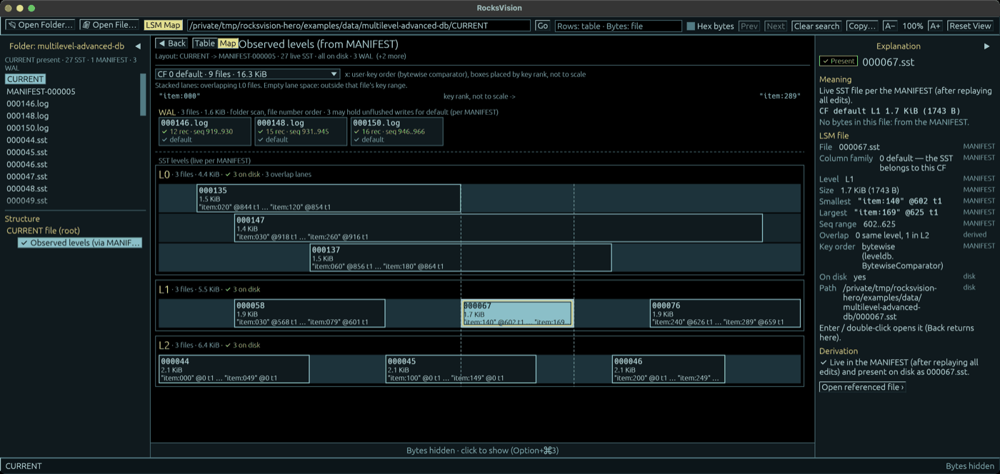

<table>
  <tr>
    <td valign="middle"></td>
    <td valign="middle"><h1>RocksVision</h1></td>
  </tr>
</table>

[English](README.md) · [Türkçe](README.tr.md)

Explore RocksDB from the LSM tree down to individual bytes: inspect WAL and SST files, see column families and levels recorded in the MANIFEST, and trace decoded fields back to the bytes that hold them.

## Table of contents

- [About](#about)
- [UI and themes](#ui-and-themes)
- [Usage](#usage)
- [Build](#build)
- [Status and limitations](#status-and-limitations)
- [License](#license)

## About

**RocksVision is a read-only desktop file inspector for people learning or debugging RocksDB.** Explore WAL, SST, MANIFEST and CURRENT files, follow their structures, and connect decoded fields to the bytes that produced them.

Built with Rust and egui, it targets **RocksDB 10.4.2** file formats. It reads files directly: **you do not need to install or run RocksDB to use RocksVision**, including the ready-to-open examples in this repository. Generating new examples is a separate developer task.

- Inspect a database directory or a standalone SST/WAL file.
- Explore records, keys, values, block indexes, Bloom filters and MANIFEST-derived LSM levels.
- Switch between stored bytes and clearly labeled decompressed/reassembled byte spaces.
- Inspect checksum failures and truncation diagnostics, with byte ranges and explanations where available.
- Search, copy, resize panels, adjust text size and choose from six themes.

RocksVision does not modify, repair, replay or compact the inspected database. It is an independent project, not an official RocksDB tool.

## UI and themes

The default XCopy theme on a standalone ZSTD-compressed SST, with a decoded entry selected and its **decompressed block bytes** highlighted (click any screenshot for the full-resolution original; all originals are under [screenshots/highres/](screenshots/highres/)):

### Themes

Choose a look from **View → Theme**. Changing the theme does not change the data or file contents.

| Theme | Appearance |
|---|---|
| Autistic | Dark grey with warm brown accents |
| Matrix | Black background with lime-green terminal styling |
| Amiga Workbench | Blue surfaces, white text and orange selection |
| Amiga Tool Style | Light grey surfaces, dark text and blue selection |
| XCopy (default) | Black background with cyan and yellow accents |
| Wooden | Wood-textured chrome, brass accents and plain data surfaces |

Screenshots of all six themes (previews; each links to its full-resolution file):

| Matrix | Amiga Workbench |
|---|---|
|  |  |
| **Amiga Tool Style** | **XCopy** |
|  |  |
| **Wooden** | **Autistic** |
|  |  |

### Menus

| Menu | Purpose |
|---|---|
| File | Open a standalone file or database directory; jump to a byte offset |
| View | Search, zoom, themes, LSM Map, panel visibility, Show Tooltips and Reset View |
| Help | RocksVision Help and Keyboard Shortcuts |
| RocksVision (macOS) | About, Hide and Quit |

macOS uses the system menu bar; other platforms use an in-window menu. The following screenshot shows **View → Theme** and the panel controls:

## Usage

Build and launch the application using the instructions below. You can open a folder or file with **Open Folder…** / **Open File…**, or type a path and press **Go**.

### Included examples

- **`examples/data/`** holds complete database folders (CURRENT, MANIFEST, SST and WAL files). Open a scenario folder such as `multilevel-advanced-db` with **Open Folder…**, not the parent `data/` folder.
- **`examples/files/`** holds single files. Open the `.sst`, `.log`, CURRENT or MANIFEST file itself with **Open File…**.

Both open without installing or running RocksDB; the generators that produced them are separate developer tooling. The [example guide](examples/README.md) describes every scenario.

### Walkthrough 1: the LSM tree

1. **Open Folder…** → [`examples/data/multilevel-advanced-db/`](examples/data/multilevel-advanced-db/).
2. Press **LSM Map** in the toolbar (⇧⌘M; Ctrl+Shift+M on Windows/Linux).
3. Choose a column family in the selector above the map.
4. Hover an SST box or WAL card for a tooltip; click it to show its facts in the Explanation.
5. Double-click it (or press Enter) to open the file.
6. **◀ Back** returns to the map. **Table | Map** switches between the map and the levels table.

### Walkthrough 2: an SST down to bytes

1. **Open File…** → [`examples/files/sst-zstd/sst-zstd.sst`](examples/files/sst-zstd/sst-zstd.sst).
2. In the structure tree, select a data block, then select an entry in the table.
3. Its bytes are highlighted below. The Explanation shows the offset inside the decompressed block and the file range of the compressed block that holds it.
4. **show file bytes** shows the stored bytes; **show block@0x… (decompressed)** goes back.

An SST inside a database folder also shows `level (MANIFEST)` and `column family (MANIFEST)` rows (and `--dump` prints them) when the folder's CURRENT names a MANIFEST that lists it: external evidence, not stored in the SST. Otherwise the `level` row says why it is unknown, as for this standalone example.

### Walkthrough 3: a WAL

1. **Open File…** → [`examples/files/wal-plain/000004.log`](examples/files/wal-plain/000004.log).
2. **Physical blocks** lists the stored fragments; **Logical records (reassembled view)** lists the reassembled WriteBatches.
3. Select a WriteBatch, then one of its operations and its key and value fields.
4. The byte view shows file offsets (**FILE**); **show record@0x… (reassembled)** switches to record offsets (**RECORD+**).

### Controls at a glance

- **Search:** type in the search field; **Enter** / **Shift+Enter** or **Next** / **Prev** move between matches.
- **Map vs. app zoom:** when the map is larger than its area, **Center**, **Fit**, **−** and **+** appear above it and move only the map; **A−** / **A+** scale the whole application.
- **Map keyboard:** while the map has focus, use the arrows to select, **Enter** to open, **Esc** to leave, **0** for Fit and **C** for Center. **LSM Map** (⇧⌘M) gives the map focus again.
- **Tooltips:** **View → Show Tooltips** turns hover tooltips on or off; the Explanation shows the same facts.
- **Layout:** **Reset View** restores the panel layout and 100 % zoom.

For comparisons, try `data/bloom-full`, `data/bloom-absent`, `data/index-partitioned`, `data/codec-*` and `data/multilevel-db`. The `files/corrupt-*` samples are intentionally damaged: select the affected element to inspect available **Diagnosis** information. Most examples are valid, not corrupt. The [example guide](examples/README.md) documents scenarios and expected observations.

### Screen layout

**The screen has four connected areas:**

| Area | What it shows |
|---|---|
| Left — Navigation | Files; the structure tree in physical file order (each block once, SST Footer last), then labeled views (logical records, observed levels, data blocks via index) |
| Center top — Records | Fields and records of the selected structure, with its file range, stored size and next structure |
| Center bottom — Bytes | Offsets (FILE / BLOCK+ / RECORD+), hex and ASCII; synchronized with selection in both directions |
| Right — Explanation | Meaning, where (every address space, file first), diagnosis, derivation and, collapsed, other byte interpretations |

Select a row to highlight its bytes; click a byte to select the field that holds it (the byte stays outlined); **Shift+click** selects a raw range. Double-click a link, handle or reference to go to the structure at its place in the tree; **Back** returns. **]** / **[** step through fields, **Shift+]** / **Shift+[** through structures. **File** offsets and **Decompressed block / Reassembled record** offsets are different address spaces: a reassembled field shows its exact file range(s); a decompressed field only the compressed block that contains it. A standalone SST cannot establish its LSM level without MANIFEST context.

Search checks decoded cells of the current table and stored file bytes, not every decoded table or decompressed block. **Hex bytes** accepts a pattern such as `4d 41 4e`. In the search field, **Enter** advances and **Shift+Enter** goes back.

Use **View** for themes, panel visibility and zoom. Text size (A− / A+) goes up to the largest zoom at which the whole layout still fits: 160 % at 1400×900, 100 % at 900×700 and 100 % at 900×560 (measured in rendered frames with the default XCopy theme; the ceiling keeps at least three table rows and eight bytes per row, and above 100 % the side panels shrink toward their minimum widths, returning to your widths when you zoom out). A+ is disabled at that ceiling; a larger window raises it. When the window becomes too small for your zoom, the zoom is lowered to fit (the status bar says "Zoom reduced to N% to fit window") and returns to your zoom by itself when the window is large enough again; your zoom and window size are what the next launch restores. "Checked" means a block's checksum and trailer were verified: opening a block checks it, and listing up to 64 blocks in the tree reads and checks those blocks; the others say "Not checked". **Reset View** restores the internal layout and 100% zoom; it does not resize the window. **Help → RocksVision Help** explains the interface and **Keyboard Shortcuts** lists the keys. macOS uses native menus; other platforms have an in-window menu.

## Build

Run the appropriate script from the checkout root on the matching operating system:

| Platform | Command | Application output |
|---|---|---|
| macOS Apple Silicon | `./scripts/build-macos-arm64.sh` | `dist/macos-arm64/RocksVision.app` |
| macOS Intel | `./scripts/build-macos-x64.sh` | `dist/macos-x64/RocksVision.app` |
| Ubuntu 22.04 / 24.04 x64 | `./scripts/build-ubuntu-x64.sh` | `dist/ubuntu-x64/rocksvision` |
| Windows 10 / 11 x64 | `powershell -NoProfile -ExecutionPolicy Bypass -File scripts\build-windows-x64.ps1` | `dist/windows-x64/rocksvision.exe` |

Scripts check prerequisites, bootstrap missing tools where supported, and build using the pinned Rust toolchain and `Cargo.lock`. Initial setup may require administrator permission, Apple's developer tools/license acceptance or a Windows restart; scripts do not restart the machine themselves. Internet access is needed for missing tools and dependencies.

Open the macOS `.app` in Finder, run the Windows `.exe`, or launch `./dist/ubuntu-x64/rocksvision` from an Ubuntu desktop session. Each script also produces a ZIP/tar.gz package, build information and SHA-256 checksums under `dist/`. Linux desktop/runtime requirements and setup details are in the [build guide](docs/BUILD.md).

**Verification status:** v0.1.2 was built, packaged and tested by CI on all four platforms (macOS ARM, macOS Intel, Ubuntu, Windows) and released; its packaged macOS ARM app was checked in its GUI. Ubuntu GUI launch is not yet tested. Version 0.1.4 is in development (latest release 0.1.3) and awaits its CI run.

## Status and limitations

Version **0.1.4** (in development; latest release 0.1.3) is an early inspection tool. Format coverage is not universal; unsupported features and unavailable context must be distinguished from absent or corrupt data. Checks do not guarantee detection of every damaged file.

The LSM Map shows the final state the MANIFEST records, not memtable, flush or compaction history, and it shows no link between a WAL and SST files. An SST opened on its own has no level: only its folder's MANIFEST records one. Layouts are verified for RocksDB 10.4.2 on the included examples; the four-platform CI run for the current version is pending.

Known follow-ups include narrow-window paging controls, Matrix toolbar clipping, and propagation of incomplete WAL-fragment diagnostics to the root summary. macOS packages are ad-hoc signed, not notarized. See the [build guide](docs/BUILD.md) for platform-specific limitations.

## License

Copyright 2026 TA2LDV. RocksVision is licensed under the [Apache License 2.0](LICENSE). Third-party components retain their own licenses; see [third-party notices](THIRD-PARTY-LICENSES.md).
