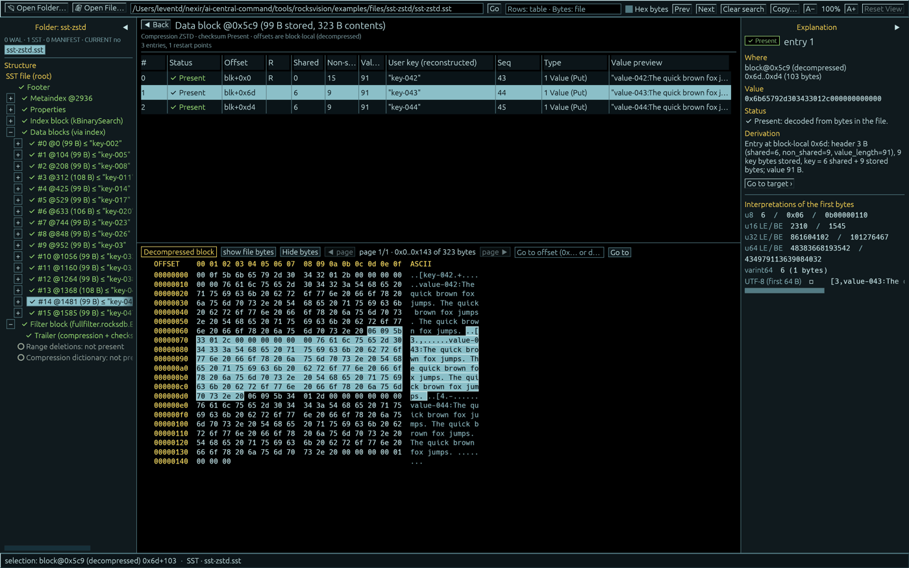
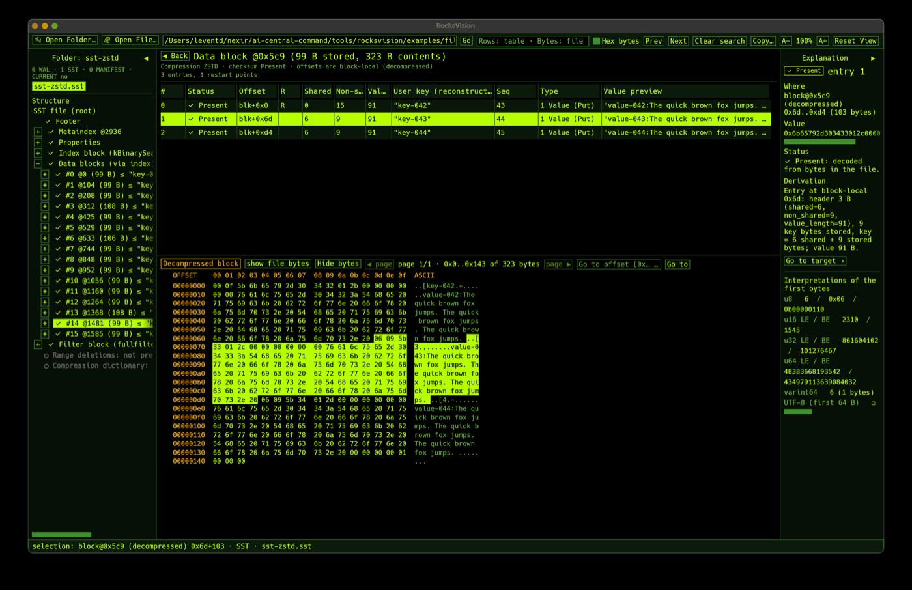
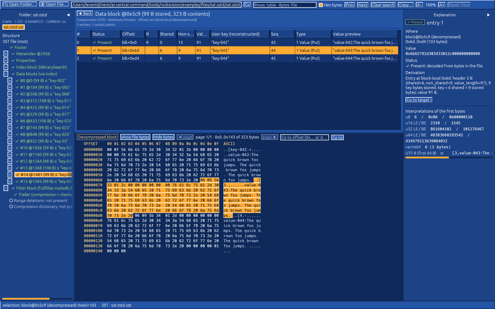
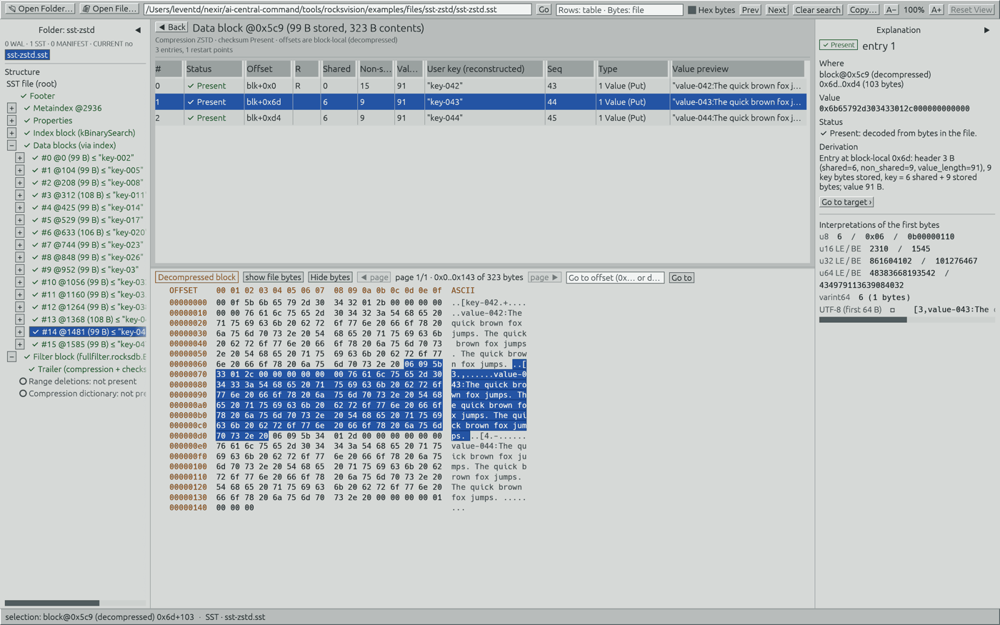
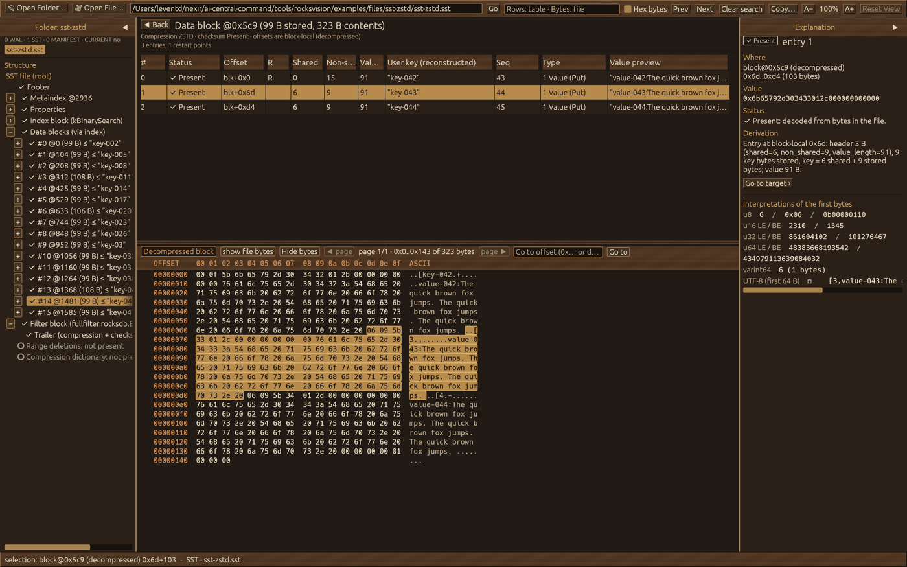
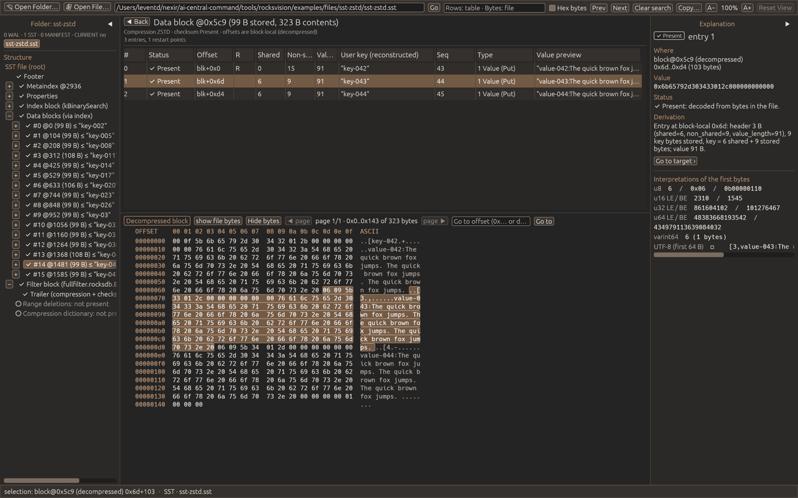
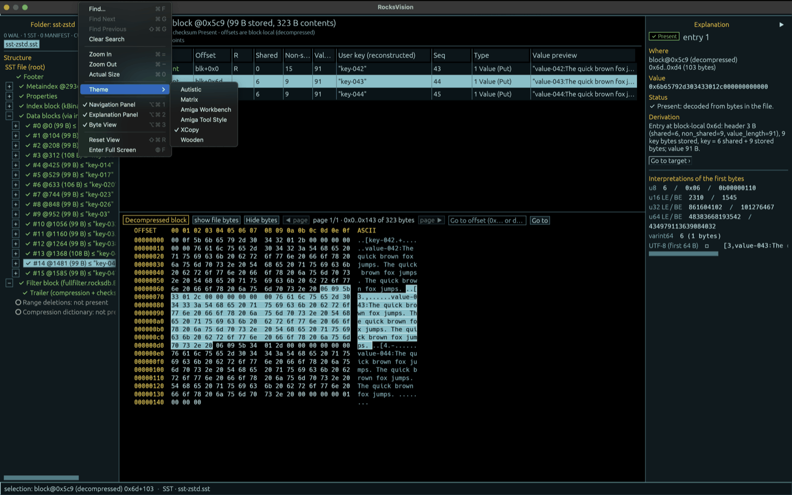
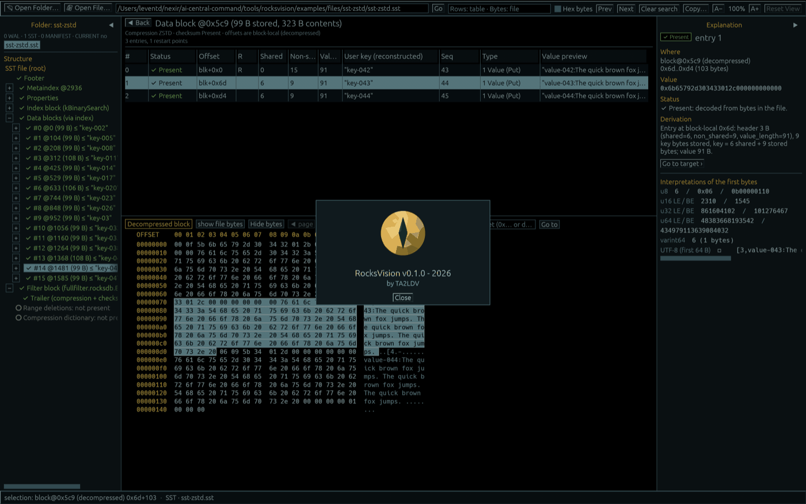

<table>
  <tr>
    <td valign="middle"></td>
    <td valign="middle"><h1>RocksVision</h1></td>
  </tr>
</table>

[English](README.md) · [Türkçe](README.tr.md)

## Table of contents

- [About](#about)
- [UI and themes](#ui-and-themes)
- [Usage](#usage)
- [Build](#build)
- [Status and limitations](#status-and-limitations)
- [License](#license)

## About

**RocksVision is a read-only desktop file inspector for people learning or debugging RocksDB.** Explore WAL, SST, MANIFEST and CURRENT files, follow their structures, and connect decoded fields to the bytes that produced them.

Built with Rust and egui, it targets **RocksDB 10.4.2** file formats. It reads files directly: **you do not need to install or run RocksDB to use RocksVision**, including the ready-to-open examples in this repository. Generating new examples is a separate developer task.

- Inspect a database directory or a standalone SST/WAL file.
- Explore records, keys, values, block indexes, Bloom filters and MANIFEST-derived LSM levels.
- Switch between stored bytes and clearly labeled decompressed/reassembled byte spaces.
- Inspect checksum failures and truncation diagnostics, with byte ranges and explanations where available.
- Search, copy, resize panels, adjust text size and choose from six themes.

RocksVision does not modify, repair, replay or compact the inspected database. It is an independent project, not an official RocksDB tool.

## UI and themes

The default XCopy theme on a standalone ZSTD-compressed SST, with a decoded entry selected and its **decompressed block bytes** highlighted (click any screenshot for the full-resolution original; all originals are under [screenshots/highres/](screenshots/highres/)):

### Themes

Choose a look from **View → Theme**. Changing the theme does not change the data or file contents.

| Theme | Appearance |
|---|---|
| Autistic | Dark grey with warm brown accents |
| Matrix | Black background with lime-green terminal styling |
| Amiga Workbench | Blue surfaces, white text and orange selection |
| Amiga Tool Style | Light grey surfaces, dark text and blue selection |
| XCopy (default) | Black background with cyan and yellow accents |
| Wooden | Wood-textured chrome, brass accents and plain data surfaces |

Screenshots of all six themes (previews; each links to its full-resolution file):

| Matrix | Amiga Workbench |
|---|---|
|  |  |
| **Amiga Tool Style** | **XCopy** |
|  |  |
| **Wooden** | **Autistic** |
|  |  |

### Menus

| Menu | Purpose |
|---|---|
| File | Open a standalone file or database directory; jump to a byte offset |
| View | Search, zoom, themes, panel visibility and Reset View |
| Help | RocksVision Help and Keyboard Shortcuts |
| RocksVision (macOS) | About, Hide and Quit |

macOS uses the system menu bar; other platforms use an in-window menu. The following screenshot shows **View → Theme** and the panel controls:

## Usage

Build and launch the application using the instructions below. Then try:

| Action | Included example |
|---|---|
| **Open Folder…** | [`examples/data/basic-db/`](examples/data/basic-db/) — a complete database directory |
| **Open File…** | [`examples/files/sst-zstd/sst-zstd.sst`](examples/files/sst-zstd/sst-zstd.sst) — one compressed SST |
| **Open File…** | [`examples/files/wal-plain/000004.log`](examples/files/wal-plain/000004.log) — one WAL, no companion files required |

You can also enter a path and press **Go**. The [example guide](examples/README.md) covers Bloom filters, index variants, compression, multiple LSM levels, fragmented WALs and clearly labeled corrupt files. Examples are already included; no data-generation step is required.

### How to use the included examples

There are two kinds of examples:

- **`examples/data/`**: Each subdirectory is a complete database example containing CURRENT, MANIFEST and the scenario’s SST/WAL files. Use **Open Folder…** and select a scenario such as `basic-db` or `multilevel-db`, not the parent `data/` directory. This lets you inspect file relationships and levels recorded in the MANIFEST.
- **`examples/files/`**: Each subdirectory contains one file for standalone inspection. Use **Open File…** and select the actual `.sst`, `.log`, CURRENT or MANIFEST file, not its containing directory. Standalone SST/WAL inspection needs no running database or companion files; information that requires missing context is not guessed.

1. Start with **Open Folder… → `examples/data/basic-db/`**.
2. Select CURRENT, MANIFEST, an SST or a WAL in the left file list, then expand its structure tree.
3. Select a row in the center to see the corresponding bytes below and its explanation on the right.
4. Try **Open File… → `examples/files/sst-zstd/sst-zstd.sst`**. Select a compressed data block and use **show decompressed block** to inspect decoded bytes; use **show file bytes** to return to the stored bytes.
5. Open **`examples/files/wal-plain/000004.log`** to explore physical WAL records and decoded operations.

For comparisons, try `data/bloom-full`, `data/bloom-absent`, `data/index-partitioned`, `data/codec-*` and `data/multilevel-db`. The `files/corrupt-*` samples are intentionally damaged: select the affected element to inspect available **Diagnosis** information. Most examples are valid, not corrupt. The [example guide](examples/README.md) documents scenarios and expected observations.

**You can try RocksVision even if you have never installed RocksDB and do not have a database of your own.** The repository includes small example datasets generated beforehand with real RocksDB 10.4.2. They are ready-made sample files for learning and trying the tool: simply open them in RocksVision. No RocksDB installation, running database or data-generation step is required. RocksVision reads the sample files without changing them.

### Screen layout

**The screen has four connected areas:**

| Area | What it shows |
|---|---|
| Left — Navigation | Files; the structure tree in physical file order (each block once, SST Footer last), then labeled views (logical records, observed levels, data blocks via index) |
| Center top — Records | Fields and records of the selected structure, with its file range, stored size and next structure |
| Center bottom — Bytes | Offsets (FILE / BLK+ / REC+), hex and ASCII; synchronized with selection in both directions |
| Right — Explanation | Meaning, where (every address space, file first), diagnosis, derivation and, collapsed, other byte interpretations |

Select a row to highlight its bytes; click a byte to select the field that holds it (the byte stays outlined); **Shift+click** selects a raw range. Double-click a link, handle or reference to go to the structure at its place in the tree; **Back** returns. **]** / **[** step through fields, **Shift+]** / **Shift+[** through structures. **File** offsets and **Decompressed block / Reassembled record** offsets are different address spaces: a reassembled field shows its exact file range(s); a decompressed field only the compressed block that contains it. A standalone SST cannot establish its LSM level without MANIFEST context.

Search checks decoded cells of the current table and stored file bytes, not every decoded table or decompressed block. **Hex bytes** accepts a pattern such as `4d 41 4e`. In the search field, **Enter** advances and **Shift+Enter** goes back.

Use **View** for themes, panel visibility and zoom. Text size (A− / A+) goes up to the largest zoom at which the whole layout still fits: 160 % at 1400×900, 100 % at 900×700 and 100 % at 900×560 (measured in rendered frames with the default XCopy theme; the ceiling keeps at least three table rows and eight bytes per row, and above 100 % the side panels shrink toward their minimum widths, returning to your widths when you zoom out). A+ is disabled at that ceiling; a larger window raises it. When the window becomes too small for your zoom, the zoom is lowered to fit (the status bar says "Zoom reduced to N% to fit window") and returns to your zoom by itself when the window is large enough again; your zoom and window size are what the next launch restores. "Checked" means a block's checksum and trailer were verified: opening a block checks it, and listing up to 64 blocks in the tree reads and checks those blocks; the others say "Not checked". **Reset View** restores the internal layout and 100% zoom; it does not resize the window. **Help → RocksVision Help** explains the interface and **Keyboard Shortcuts** lists the keys. macOS uses native menus; other platforms have an in-window menu.

## Build

Run the appropriate script from the checkout root on the matching operating system:

| Platform | Command | Application output |
|---|---|---|
| macOS Apple Silicon | `./scripts/build-macos-arm64.sh` | `dist/macos-arm64/RocksVision.app` |
| macOS Intel | `./scripts/build-macos-x64.sh` | `dist/macos-x64/RocksVision.app` |
| Ubuntu 22.04 / 24.04 x64 | `./scripts/build-ubuntu-x64.sh` | `dist/ubuntu-x64/rocksvision` |
| Windows 10 / 11 x64 | `powershell -NoProfile -ExecutionPolicy Bypass -File scripts\build-windows-x64.ps1` | `dist/windows-x64/rocksvision.exe` |

Scripts check prerequisites, bootstrap missing tools where supported, and build using the pinned Rust toolchain and `Cargo.lock`. Initial setup may require administrator permission, Apple's developer tools/license acceptance or a Windows restart; scripts do not restart the machine themselves. Internet access is needed for missing tools and dependencies.

Open the macOS `.app` in Finder, run the Windows `.exe`, or launch `./dist/ubuntu-x64/rocksvision` from an Ubuntu desktop session. Each script also produces a ZIP/tar.gz package, build information and SHA-256 checksums under `dist/`. Linux desktop/runtime requirements and setup details are in the [build guide](docs/BUILD.md).

**Verification status:** v0.1.2 was built, packaged and tested by CI on all four platforms (macOS ARM, macOS Intel, Ubuntu, Windows) and released; its packaged macOS ARM app was checked in its GUI. Ubuntu GUI launch is not yet tested. Version 0.1.3 is in development and awaits its CI run.

## Status and limitations

Version **0.1.3** is an early inspection tool. Format coverage is not universal; unsupported features and unavailable context must be distinguished from absent or corrupt data. Checks do not guarantee detection of every damaged file.

Known follow-ups include narrow-window paging controls, Matrix toolbar clipping, and propagation of incomplete WAL-fragment diagnostics to the root summary. macOS packages are ad-hoc signed, not notarized. See the [build guide](docs/BUILD.md) for platform-specific limitations.

## License

Copyright 2026 TA2LDV. RocksVision is licensed under the [Apache License 2.0](LICENSE). Third-party components retain their own licenses; see [third-party notices](THIRD-PARTY-LICENSES.md).
