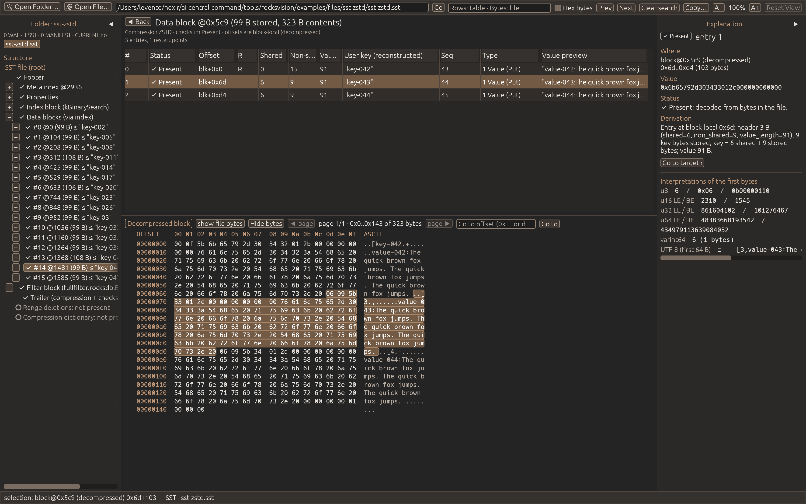
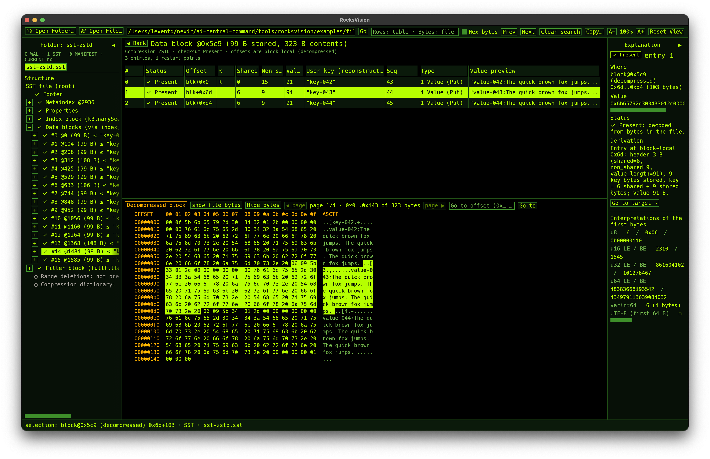
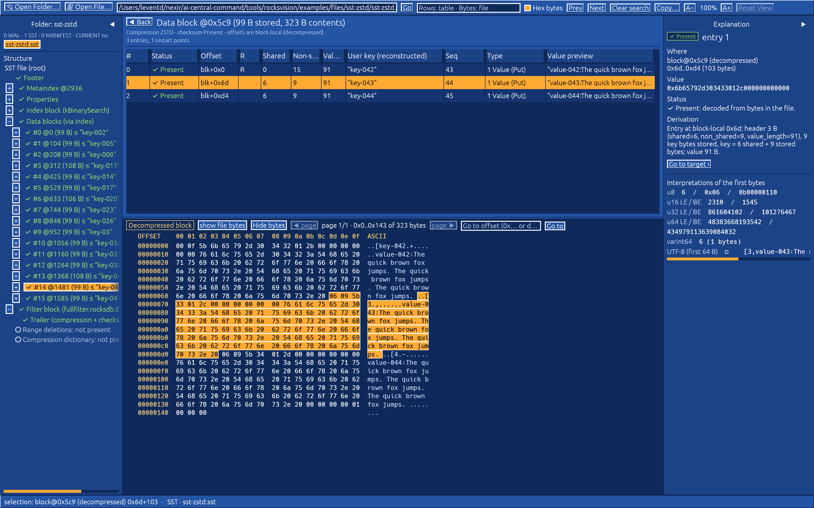
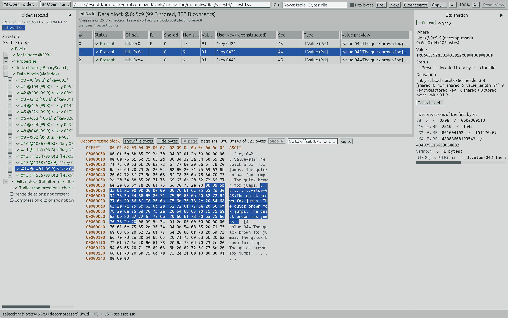
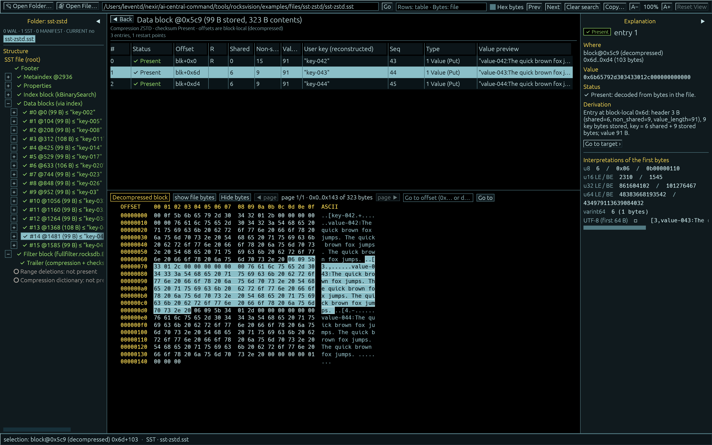
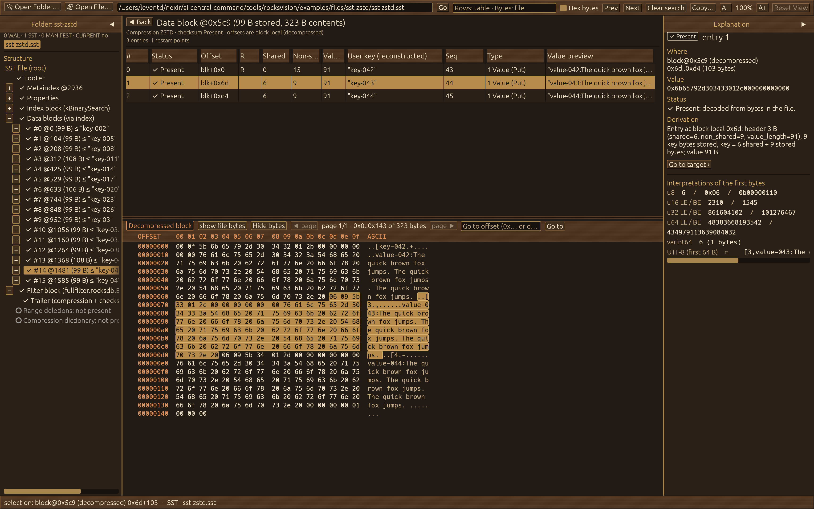
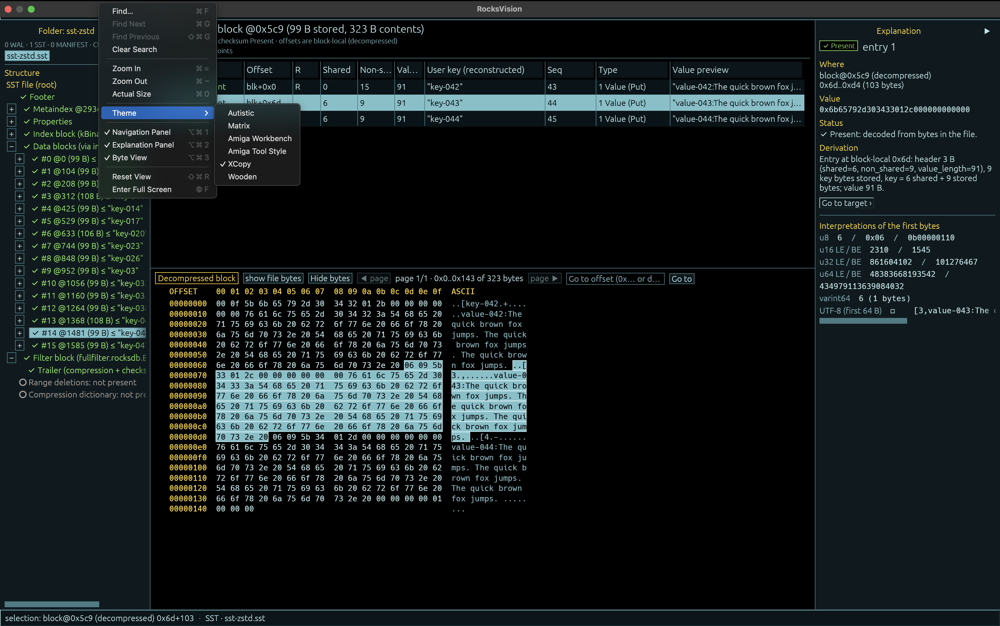
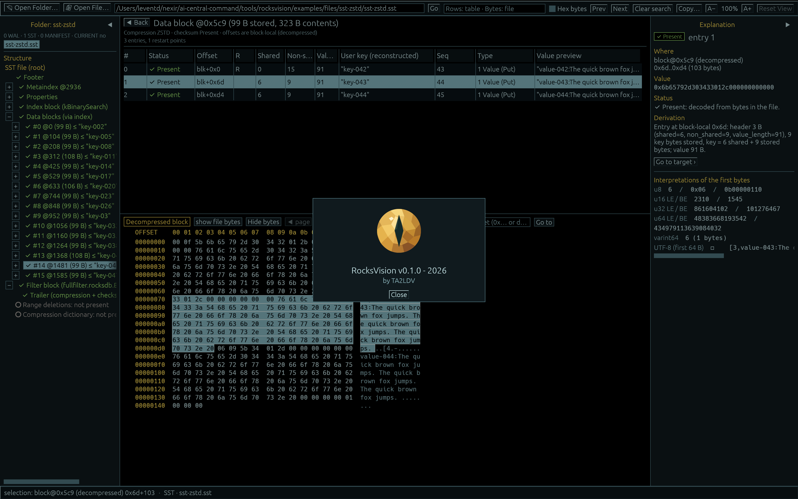

<table>
  <tr>
    <td valign="middle"></td>
    <td valign="middle"><h1>RocksVision</h1></td>
  </tr>
</table>

[English](README.md) · [Türkçe](README.tr.md)

## İçindekiler

- [Hakkında](#hakkında)
- [Ekran görüntüleri](#ekran-görüntüleri)
- [Kullanım](#kullanım)
- [Derleme](#derleme)
- [Durum ve sınırlamalar](#durum-ve-sınırlamalar)
- [Lisans](#lisans)

## Hakkında

**RocksVision, RocksDB öğrenmek veya dosyalarını debug etmek isteyenler için salt okunur bir masaüstü dosya inceleme aracıdır.** WAL, SST, MANIFEST ve CURRENT dosyalarının yapılarını keşfedin; çözümlenen alanların hangi byte’lardan üretildiğini görün.

Rust ve egui ile geliştirilmiştir; **RocksDB 10.4.2** dosya biçimlerini hedefler. Dosyaları doğrudan okur: **RocksVision’ı ve depodaki hazır örnekleri kullanmak için RocksDB kurmanız veya çalıştırmanız gerekmez.** Yeni örnek üretmek ayrı bir geliştirici işlemidir.

- Bir veritabanı klasörünü veya bağımsız SST/WAL dosyasını inceleyin.
- Kayıtları, key/value’ları, block index’lerini, Bloom filter’ları ve MANIFEST’ten elde edilen LSM seviyelerini keşfedin.
- Diskte saklanan byte’lar ile açıkça etiketlenmiş decompressed/reassembled byte alanları arasında geçiş yapın.
- Checksum uyuşmazlıklarını ve kesilmiş verileri, mevcut byte aralıkları ve açıklamalarla inceleyin.
- Arama ve kopyalama yapın; panelleri ve yazı boyutunu ayarlayın; altı temadan birini seçin.

RocksVision incelenen veritabanını değiştirmez; repair, replay veya compaction yapmaz. Bağımsız bir projedir; resmi bir RocksDB aracı değildir.

## Ekran görüntüleri

Bağımsız, ZSTD ile sıkıştırılmış bir SST: seçili kaydın **açılmış block byte’ları** vurgulanıyor.

Altı temayı inceleyin

| Matrix | Amiga Workbench |
|---|---|
|  |  |
| **Amiga Tool Style** | **XCopy** |
|  |  |
| **Wooden** | **Autistic** |
|  |  |

Tema menüsü ve About

## Kullanım

Aşağıdaki derleme adımlarından sonra uygulamayı açın ve şu örnekleri deneyin:

| İşlem | Hazır örnek |
|---|---|
| **Open Folder…** | [`examples/data/basic-db/`](examples/data/basic-db/) — tam veritabanı klasörü |
| **Open File…** | [`examples/files/sst-zstd/sst-zstd.sst`](examples/files/sst-zstd/sst-zstd.sst) — tek sıkıştırılmış SST |
| **Open File…** | [`examples/files/wal-plain/000004.log`](examples/files/wal-plain/000004.log) — yanında başka dosya gerektirmeyen tek WAL |

Dosya yolunu yazıp **Go** düğmesine de basabilirsiniz. [Örnek rehberi](examples/README.md); Bloom filter, index çeşitleri, compression, çoklu LSM seviyeleri, parçalı WAL ve açıkça adlandırılmış bozuk dosya senaryolarını anlatır. Dosyalar hazırdır; veri üretmeniz gerekmez.

**Ekran birbiriyle bağlantılı dört alandan oluşur:**

| Alan | Gösterdiği içerik |
|---|---|
| Sol — Navigation | Dosyalar ve açılabilir yapı ağacı |
| Orta üst — Records | Seçilen yapının alanları ve kayıtları |
| Orta alt — Bytes | Seçimle eşleşen offset, hex ve ASCII görünümü |
| Sağ — Explanation | Encoding, türetim, yorumlamalar ve mevcut bozulma teşhisleri |

Bir satırı seçince byte aralığı vurgulanır; bir link veya handle’a çift tıklayınca hedefe gidilir. **File** offset’leri ile **Decompressed block / Reassembled record** offset’leri farklı adres alanlarıdır. Tek bir SST’nin LSM seviyesi, MANIFEST bilgisi olmadan belirlenemez.

Arama, mevcut tablonun çözümlenmiş hücrelerinde ve dosyanın saklanan byte’larında çalışır; bütün tabloları veya açılmış block’ları taramaz. **Hex bytes**, `4d 41 4e` gibi bir byte dizisi arar. Arama kutusunda **Enter** sonraki, **Shift+Enter** önceki eşleşmeye gider.

**View** menüsünden tema, panel görünürlüğü ve zoom ayarlanır. **Reset View**, iç yerleşimi ve %100 zoom’u geri getirir; pencerenin boyutunu değiştirmez. **Help → RocksVision Help** arayüzü, **Keyboard Shortcuts** ise kısayolları açıklar. macOS’ta sistem menüleri, diğer platformlarda pencere içi menü kullanılır.

## Derleme

İlgili işletim sisteminde, depo kökünden uygun scripti çalıştırın:

| Platform | Komut | Uygulama çıktısı |
|---|---|---|
| macOS Apple Silicon | `./scripts/build-macos-arm64.sh` | `dist/macos-arm64/RocksVision.app` |
| macOS Intel | `./scripts/build-macos-x64.sh` | `dist/macos-x64/RocksVision.app` |
| Ubuntu 22.04 / 24.04 x64 | `./scripts/build-ubuntu-x64.sh` | `dist/ubuntu-x64/rocksvision` |
| Windows 10 / 11 x64 | `powershell -NoProfile -ExecutionPolicy Bypass -File scripts\build-windows-x64.ps1` | `dist/windows-x64/rocksvision.exe` |

Scriptler önkoşulları kontrol eder, desteklenen durumlarda eksik araçları kurar ve sabitlenmiş Rust toolchain’i ile `Cargo.lock` kullanarak derler. İlk kurulumda yönetici izni, Apple geliştirici araçları/lisans onayı veya Windows’u yeniden başlatmanız gerekebilir; scriptler makineyi kendileri yeniden başlatmaz. Eksik araç ve bağımlılıkları indirmek için internet gerekir.

macOS’ta `.app` dosyasını Finder’dan, Windows’ta `.exe` dosyasını açın. Ubuntu masaüstü oturumunda `./dist/ubuntu-x64/rocksvision` çalıştırın. Scriptler ayrıca `dist/` altında ZIP/tar.gz paketini, build bilgisini ve SHA-256 checksum’larını üretir. Linux masaüstü/runtime gereksinimleri ve kurulum ayrıntıları [derleme rehberindedir](docs/BUILD.md).

**Doğrulama durumu:** macOS ARM derlenmiş ve çalıştırılmıştır. macOS Intel, Ubuntu ve Windows scriptleri incelenmiştir; **bu hedeflerde derleme ve çalıştırma henüz doğrulanmamıştır.**

## Durum ve sınırlamalar

**0.1.0**, erken aşamadaki bir inceleme aracıdır. Her dosya biçimi desteklenmez; desteklenmeyen özellikler ve eksik bağlam, bulunmayan veya bozuk veriden ayrı değerlendirilmelidir. Kontroller her bozulmanın tespit edileceğini garanti etmez.

Dar pencerede sayfalama düğmeleri, Matrix toolbar taşması ve eksik WAL fragment teşhisinin kök özete aktarılması bilinen takip işleridir. macOS paketleri ad-hoc imzalıdır; notarization yapılmamıştır. Platforma özgü sınırlamalar için [derleme rehberine](docs/BUILD.md) bakın.

## Lisans

Copyright 2026 TA2LDV. RocksVision [Apache License 2.0](LICENSE) ile lisanslanmıştır. Üçüncü taraf bileşenler kendi lisanslarını korur; [üçüncü taraf bildirimlerine](THIRD-PARTY-LICENSES.md) bakın.
