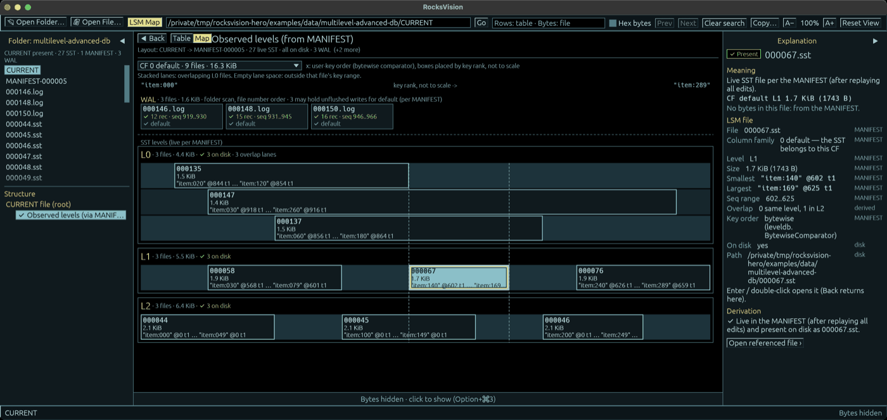
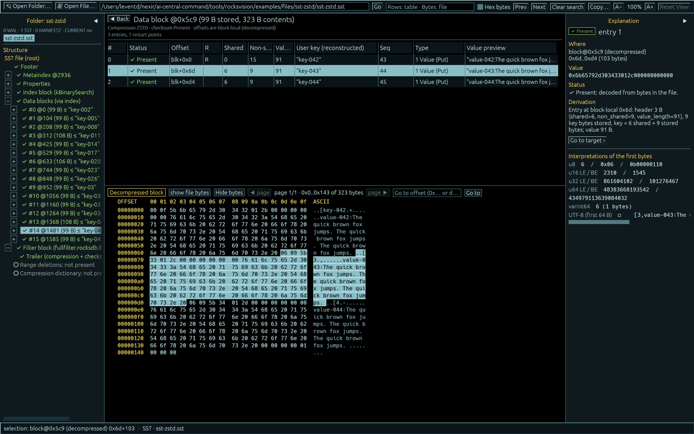
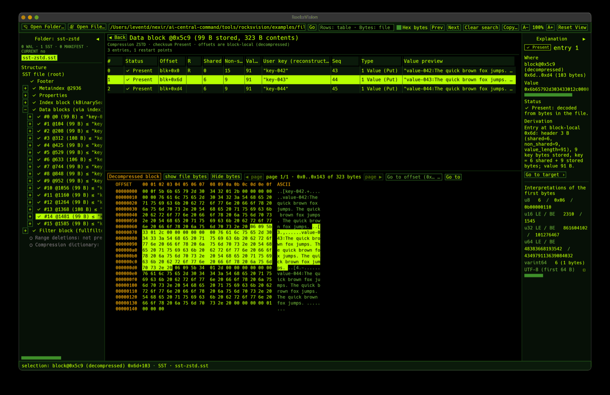
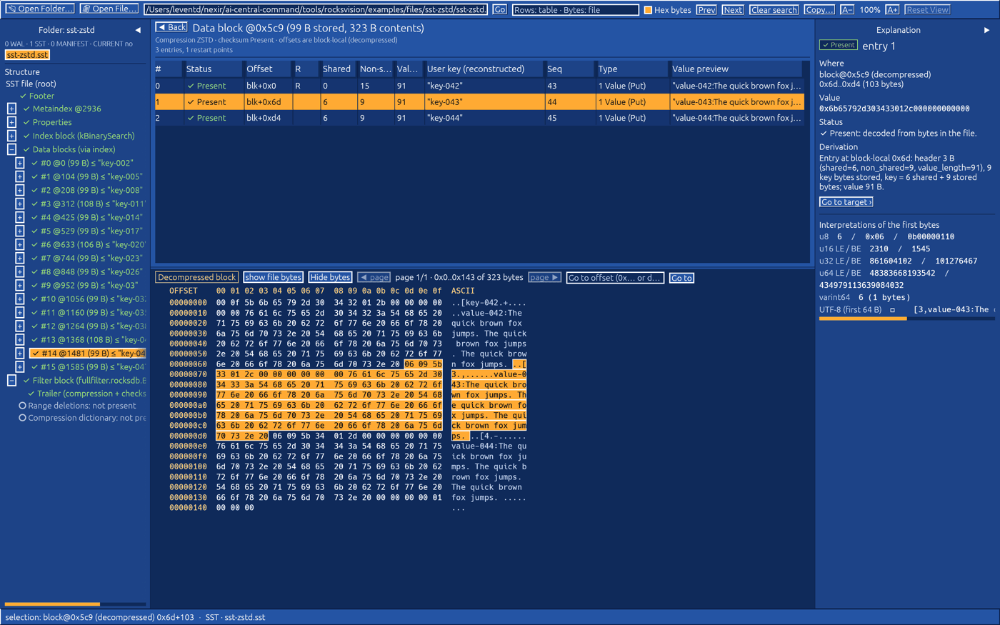
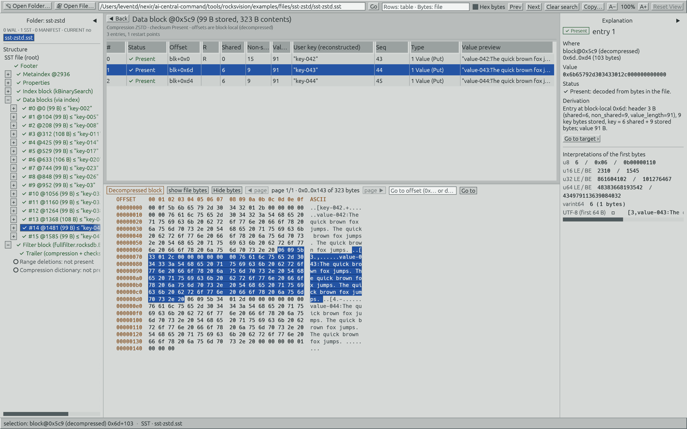
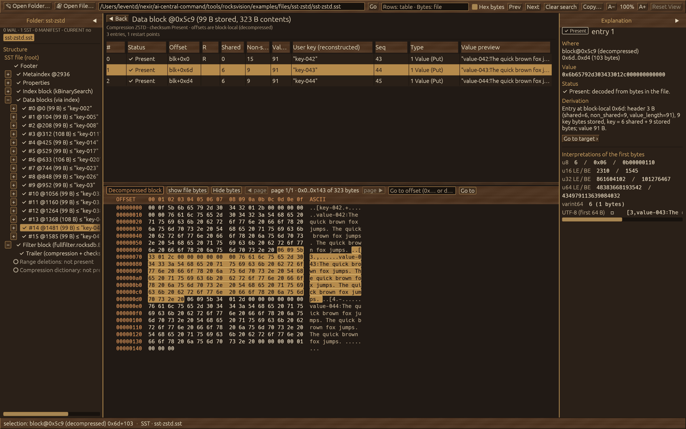
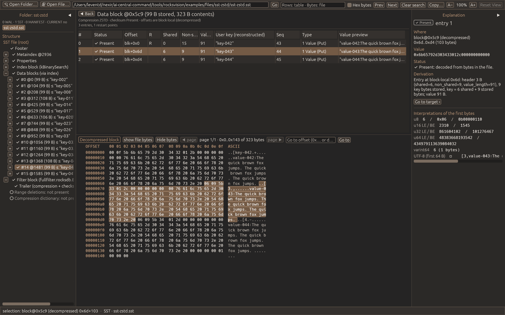
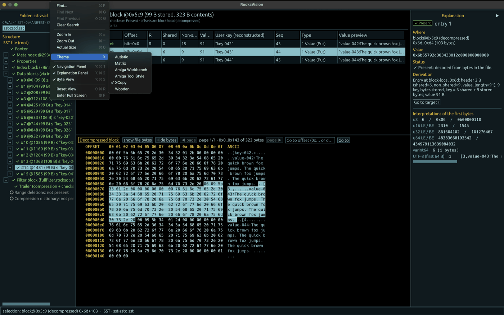
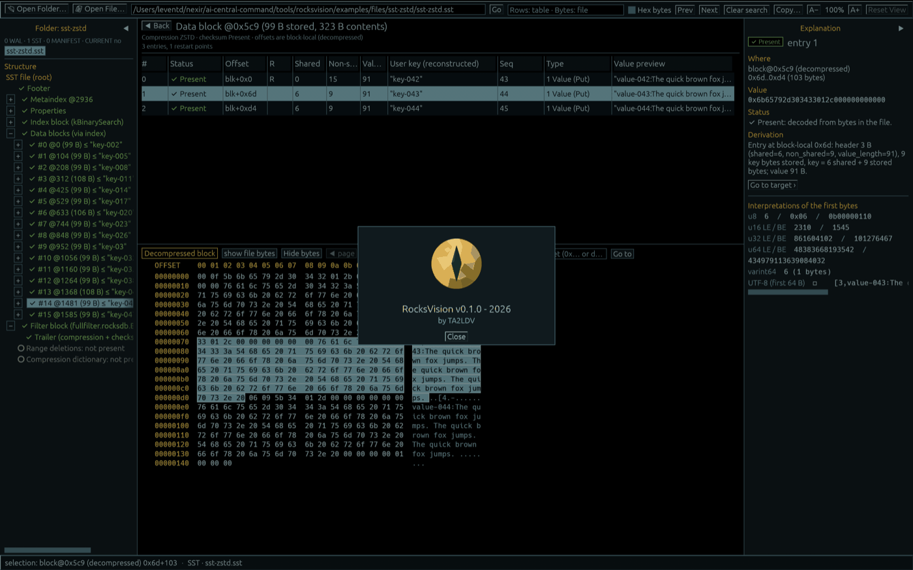

<table>
  <tr>
    <td valign="middle"></td>
    <td valign="middle"><h1>RocksVision</h1></td>
  </tr>
</table>

[English](README.md) · [Türkçe](README.tr.md)

RocksDB’yi LSM ağacından tek tek byte’lara kadar keşfedin: WAL ve SST dosyalarını inceleyin, MANIFEST’te kayıtlı column family’leri ve seviyeleri görün, çözümlenen alanları onları tutan byte’lara kadar izleyin.

## İçindekiler

- [Hakkında](#hakkında)
- [UI ve temalar](#ui-ve-temalar)
- [Kullanım](#kullanım)
- [Derleme](#derleme)
- [Durum ve sınırlamalar](#durum-ve-sınırlamalar)
- [Lisans](#lisans)

## Hakkında

**RocksVision, RocksDB öğrenmek veya dosyalarını debug etmek isteyenler için salt okunur bir masaüstü dosya inceleme aracıdır.** WAL, SST, MANIFEST ve CURRENT dosyalarının yapılarını keşfedin; çözümlenen alanların hangi byte’lardan üretildiğini görün.

Rust ve egui ile geliştirilmiştir; **RocksDB 10.4.2** dosya biçimlerini hedefler. Dosyaları doğrudan okur: **RocksVision’ı ve depodaki hazır örnekleri kullanmak için RocksDB kurmanız veya çalıştırmanız gerekmez.** Yeni örnek üretmek ayrı bir geliştirici işlemidir.

- Bir veritabanı klasörünü veya bağımsız SST/WAL dosyasını inceleyin.
- Kayıtları, key/value’ları, block index’lerini, Bloom filter’ları ve MANIFEST’ten elde edilen LSM seviyelerini keşfedin.
- Diskte saklanan byte’lar ile açıkça etiketlenmiş decompressed/reassembled byte alanları arasında geçiş yapın.
- Checksum uyuşmazlıklarını ve kesilmiş verileri, mevcut byte aralıkları ve açıklamalarla inceleyin.
- Arama ve kopyalama yapın; panelleri ve yazı boyutunu ayarlayın; altı temadan birini seçin.

RocksVision incelenen veritabanını değiştirmez; repair, replay veya compaction yapmaz. Bağımsız bir projedir; resmi bir RocksDB aracı değildir.

## UI ve temalar

Varsayılan XCopy temasında, bağımsız ve ZSTD ile sıkıştırılmış bir SST: seçili çözülmüş kaydın **açılmış block byte’ları** vurgulanıyor (tam çözünürlüklü orijinal için görsele tıklayın; tüm orijinaller [screenshots/highres/](screenshots/highres/) altında):

### Temalar

**View → Theme** menüsünden görünümü değiştirin. Tema seçimi veriyi veya dosya içeriğini değiştirmez.

| Tema | Görünüm |
|---|---|
| Autistic | Koyu gri ve sıcak kahverengi vurgular |
| Matrix | Siyah zemin, lime yeşili terminal görünümü |
| Amiga Workbench | Mavi zemin, beyaz yazı ve turuncu seçim |
| Amiga Tool Style | Açık gri yüzeyler, koyu yazı ve mavi seçim |
| XCopy (varsayılan) | Siyah zemin, cyan ve sarı vurgular |
| Wooden | Ahşap dokulu çerçeveler, pirinç tonları ve düz veri alanları |

Altı temanın ekran görüntüleri (önizleme; her biri tam çözünürlüklü dosyasına bağlıdır):

| Matrix | Amiga Workbench |
|---|---|
|  |  |
| **Amiga Tool Style** | **XCopy** |
|  |  |
| **Wooden** | **Autistic** |
|  |  |

### Menüler

| Menü | İşlev |
|---|---|
| File | Open File ile tek dosya, Open Folder ile veritabanı klasörü açma; Go to Offset ile byte konumuna gitme |
| View | Arama, zoom, tema, LSM Map, panel görünürlüğü, Show Tooltips ve Reset View |
| Help | RocksVision Help ve Keyboard Shortcuts |
| RocksVision (macOS) | About, uygulamayı gizleme ve çıkış |

macOS’ta menüler sistem menü çubuğundadır; diğer platformlarda pencere içi menü kullanılır. Aşağıdaki görsel **View → Theme** menüsünü ve panel seçeneklerini gösterir:

## Kullanım

Aşağıdaki derleme adımlarından sonra uygulamayı açın. Klasör veya dosyayı **Open Folder…** / **Open File…** ile açabilir ya da yolu yazıp **Go** düğmesine basabilirsiniz.

### Hazır örnekler

- **`examples/data/`** tam veritabanı klasörlerini içerir (CURRENT, MANIFEST, SST ve WAL dosyaları). `multilevel-advanced-db` gibi bir senaryo klasörünü **Open Folder…** ile açın; üst klasör `data/`’yı değil.
- **`examples/files/`** tek dosyaları içerir. `.sst`, `.log`, CURRENT veya MANIFEST dosyasının kendisini **Open File…** ile açın.

İkisi de RocksDB kurmadan veya çalıştırmadan açılır; onları üreten araçlar ayrı geliştirici araçlarıdır. Her senaryo [örnek rehberinde](examples/README.md) anlatılır.

### Adım adım 1: LSM ağacı

1. **Open Folder…** → [`examples/data/multilevel-advanced-db/`](examples/data/multilevel-advanced-db/).
2. Toolbar’daki **LSM Map** düğmesine basın (⇧⌘M; Windows/Linux’ta Ctrl+Shift+M).
3. Haritanın üstündeki seçiciden bir column family seçin.
4. Tooltip için bir SST kutusunun veya WAL kartının üzerine gelin; bilgilerini Explanation’da görmek için tıklayın.
5. Dosyayı açmak için çift tıklayın (veya Enter’a basın).
6. **◀ Back** haritaya döner. **Table | Map**, harita ile seviye tablosu arasında geçiş yapar.

### Adım adım 2: SST’den byte’lara

1. **Open File…** → [`examples/files/sst-zstd/sst-zstd.sst`](examples/files/sst-zstd/sst-zstd.sst).
2. Yapı ağacında bir data block, ardından tabloda bir entry seçin.
3. Byte’ları altta vurgulanır. Explanation, açılmış block içindeki offset’i ve onu tutan sıkıştırılmış block’un dosya aralığını gösterir.
4. **show file bytes** diskte saklanan byte’ları gösterir; **show block@0x… (decompressed)** geri götürür.

Bir veritabanı klasöründeki SST, klasörün CURRENT dosyasının gösterdiği MANIFEST onu listeliyorsa ayrıca `level (MANIFEST)` ve `column family (MANIFEST)` satırlarını gösterir (`--dump` da bunları yazar): bunlar SST’nin içinde saklanmayan dış kanıttır. Aksi hâlde `level` satırı, bu tek başına açılan örnekte olduğu gibi, seviyenin neden bilinmediğini (unknown) söyler.

### Adım adım 3: WAL

1. **Open File…** → [`examples/files/wal-plain/000004.log`](examples/files/wal-plain/000004.log).
2. **Physical blocks** saklanan fragment’ları, **Logical records (reassembled view)** yeniden birleştirilmiş WriteBatch’leri listeler.
3. Bir WriteBatch, ardından işlemlerinden birini ve key/value alanlarını seçin.
4. Byte görünümü dosya offset’lerini (**FILE**) gösterir; **show record@0x… (reassembled)** kayıt offset’lerine (**RECORD+**) geçer.

### Kısaca kontroller

- **Arama:** arama kutusuna yazın; **Enter** / **Shift+Enter** veya **Next** / **Prev** eşleşmeler arasında gezinir.
- **Harita ve uygulama zoom’u:** harita alanından büyük olduğunda üstünde **Center**, **Fit**, **−** ve **+** görünür ve yalnızca haritayı hareket ettirir; **A−** / **A+** tüm uygulamayı ölçekler.
- **Harita klavyesi:** harita odaktayken oklar seçer, **Enter** açar, **Esc** haritadan çıkar, **0** Fit, **C** Center yapar. **LSM Map** (⇧⌘M) odağı haritaya geri verir.
- **Tooltip’ler:** **View → Show Tooltips** tooltip’leri açıp kapatır; aynı bilgiler Explanation’da da vardır.
- **Yerleşim:** **Reset View** panel yerleşimini ve %100 zoom’u geri getirir.

Karşılaştırma için `data/bloom-full`, `data/bloom-absent`, `data/index-partitioned`, `data/codec-*` ve `data/multilevel-db` klasörlerini deneyin. `files/corrupt-*` örnekleri kasıtlı olarak bozuktur: ilgili hatalı öğeyi seçince mevcut **Diagnosis** bilgilerini inceleyin. Normal örnekler de vardır; bütün dosyalar bozuk değildir. Ayrıntılı senaryolar ve beklenen sonuçlar [örnek rehberinde](examples/README.md) yer alır.

### Ekran yerleşimi

**Ekran birbiriyle bağlantılı dört alandan oluşur:**

| Alan | Gösterdiği içerik |
|---|---|
| Sol — Navigation | Dosyalar ve açılabilir yapı ağacı |
| Orta üst — Records | Seçilen yapının alanları ve kayıtları |
| Orta alt — Bytes | Seçimle eşleşen offset, hex ve ASCII görünümü |
| Sağ — Explanation | Encoding, türetim, yorumlamalar ve mevcut bozulma teşhisleri |

Bir satırı seçince byte aralığı vurgulanır; bir link veya handle’a çift tıklayınca hedefe gidilir. **File** offset’leri ile **Decompressed block / Reassembled record** offset’leri farklı adres alanlarıdır. Tek bir SST’nin LSM seviyesi, MANIFEST bilgisi olmadan belirlenemez.

Arama, mevcut tablonun çözümlenmiş hücrelerinde ve dosyanın saklanan byte’larında çalışır; bütün tabloları veya açılmış block’ları taramaz. **Hex bytes**, `4d 41 4e` gibi bir byte dizisi arar. Arama kutusunda **Enter** sonraki, **Shift+Enter** önceki eşleşmeye gider.

**View** menüsünden tema, panel görünürlüğü ve zoom ayarlanır. Yazı boyutu (A− / A+) tüm yerleşimin hâlâ sığdığı en büyük zoom’a kadar çıkar: 1400×900’de %160, 900×700’de %100, 900×560’ta %100 (varsayılan XCopy temasıyla çizilen karelerde ölçüldü; tavan en az üç tablo satırı ve satır başına sekiz byte bırakır, %100’ün üstünde yan paneller en küçük genişliklerine doğru daralır ve uzaklaştırınca sizin genişliklerinize döner); o tavanda A+ devre dışıdır, daha büyük pencere tavanı yükseltir. Pencere seçtiğiniz zoom için küçülürse zoom sığacak kadar düşürülür (durum çubuğu: “Zoom reduced to N% to fit window”) ve pencere yeniden yeterince büyüyünce kendiliğinden sizin zoom’unuza döner; bir sonraki açılış sizin zoom’unuzu ve pencere boyutunuzu geri getirir. “Checked”, bir block’un checksum ve trailer’ının doğrulandığı anlamına gelir: block’u açmak onu kontrol eder, ağaçta en fazla 64 block listelemek o block’ları okuyup kontrol eder; diğerleri “Not checked” yazar. **Reset View**, iç yerleşimi ve %100 zoom’u geri getirir; pencerenin boyutunu değiştirmez. **Help → RocksVision Help** arayüzü, **Keyboard Shortcuts** ise kısayolları açıklar. macOS’ta sistem menüleri, diğer platformlarda pencere içi menü kullanılır.

## Derleme

İlgili işletim sisteminde, depo kökünden uygun scripti çalıştırın:

| Platform | Komut | Uygulama çıktısı |
|---|---|---|
| macOS Apple Silicon | `./scripts/build-macos-arm64.sh` | `dist/macos-arm64/RocksVision.app` |
| macOS Intel | `./scripts/build-macos-x64.sh` | `dist/macos-x64/RocksVision.app` |
| Ubuntu 22.04 / 24.04 x64 | `./scripts/build-ubuntu-x64.sh` | `dist/ubuntu-x64/rocksvision` |
| Windows 10 / 11 x64 | `powershell -NoProfile -ExecutionPolicy Bypass -File scripts\build-windows-x64.ps1` | `dist/windows-x64/rocksvision.exe` |

Scriptler önkoşulları kontrol eder, desteklenen durumlarda eksik araçları kurar ve sabitlenmiş Rust toolchain’i ile `Cargo.lock` kullanarak derler. İlk kurulumda yönetici izni, Apple geliştirici araçları/lisans onayı veya Windows’u yeniden başlatmanız gerekebilir; scriptler makineyi kendileri yeniden başlatmaz. Eksik araç ve bağımlılıkları indirmek için internet gerekir.

macOS’ta `.app` dosyasını Finder’dan, Windows’ta `.exe` dosyasını açın. Ubuntu masaüstü oturumunda `./dist/ubuntu-x64/rocksvision` çalıştırın. Scriptler ayrıca `dist/` altında ZIP/tar.gz paketini, build bilgisini ve SHA-256 checksum’larını üretir. Linux masaüstü/runtime gereksinimleri ve kurulum ayrıntıları [derleme rehberindedir](docs/BUILD.md).

**Doğrulama durumu:** macOS ARM derlenmiş ve çalıştırılmıştır. macOS Intel, Ubuntu ve Windows scriptleri incelenmiştir; **bu hedeflerde derleme ve çalıştırma henüz doğrulanmamıştır.**

## Durum ve sınırlamalar

**0.1.4** (geliştirme aşamasında; son sürüm 0.1.3), erken aşamadaki bir inceleme aracıdır. Her dosya biçimi desteklenmez; desteklenmeyen özellikler ve eksik bağlam, bulunmayan veya bozuk veriden ayrı değerlendirilmelidir. Kontroller her bozulmanın tespit edileceğini garanti etmez.

LSM Map, MANIFEST’in kaydettiği son durumu gösterir; memtable, flush veya compaction geçmişini göstermez ve WAL ile SST dosyaları arasında bağ kurmaz. Tek başına açılan bir SST’nin seviyesi yoktur: seviyeyi yalnızca klasörünün MANIFEST’i kaydeder. Biçimler, depodaki örnekler üzerinde RocksDB 10.4.2 için doğrulanmıştır; güncel sürüm için dört platformlu CI çalıştırması beklemektedir.

Dar pencerede sayfalama düğmeleri, Matrix toolbar taşması ve eksik WAL fragment teşhisinin kök özete aktarılması bilinen takip işleridir. macOS paketleri ad-hoc imzalıdır; notarization yapılmamıştır. Platforma özgü sınırlamalar için [derleme rehberine](docs/BUILD.md) bakın.

## Lisans

Copyright 2026 TA2LDV. RocksVision [Apache License 2.0](LICENSE) ile lisanslanmıştır. Üçüncü taraf bileşenler kendi lisanslarını korur; [üçüncü taraf bildirimlerine](THIRD-PARTY-LICENSES.md) bakın.
